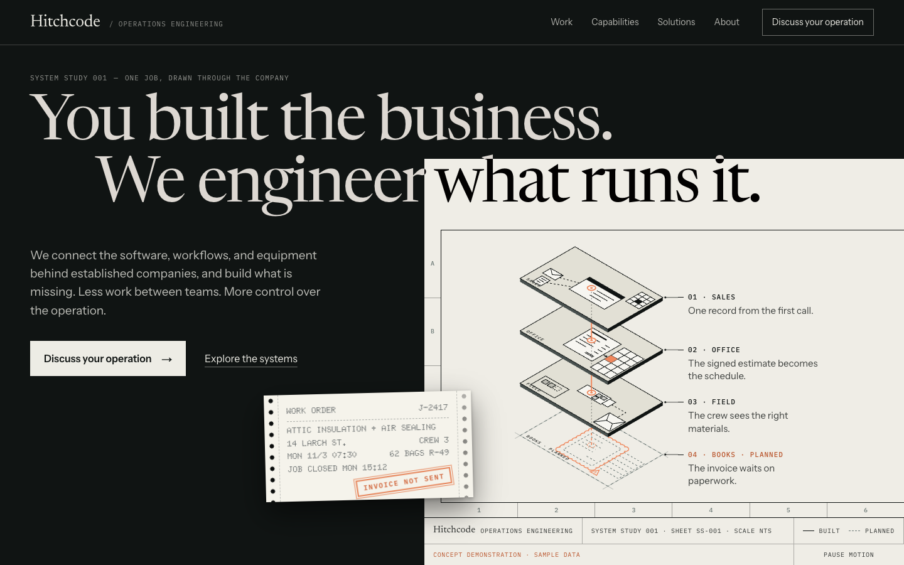
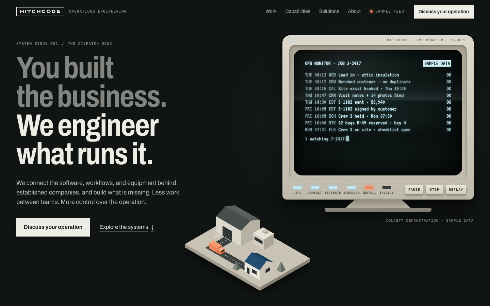
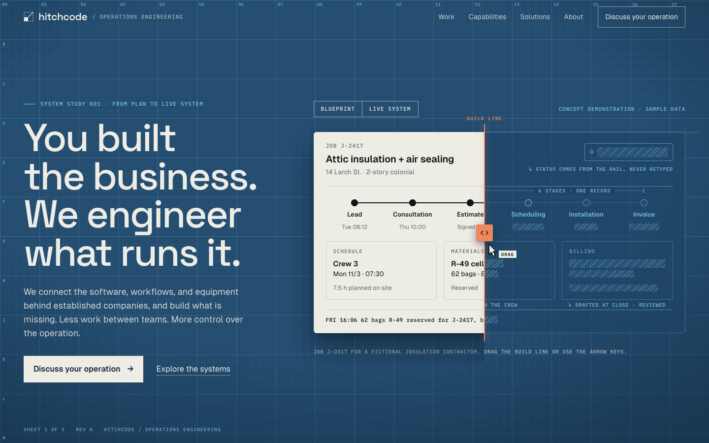

# Gate 2 — Hero explorations: decision brief

Three rendered studies, one message. Each uses the approved headline, subhead and calls to action, and the same synthetic job (J-2417, a fictional insulation contractor), labelled "Concept demonstration · sample data".

**Recommendation:** choose **A, Technical Atelier,** as the site's art direction. Carry C's build line forward as the section-05 signature module and B's terminal as the section-07 managed-outputs artifact. Reasoning is at the end.

## Where to look

| Study | Route | Desktop | Phone |
| --- | --- | --- | --- |
| Index | `/design-lab` | | |
| A · Technical Atelier | `/design-lab/a` | [1440×900](screenshots/gate-2/design-lab-a/1440x900-settled.png) | [390×844](screenshots/gate-2/design-lab-a/390x844-settled.png) · [full page](screenshots/gate-2/full-page/design-lab-a/390x844-settled-full.png) |
| B · The Control Room | `/design-lab/b` | [1440×900](screenshots/gate-2/design-lab-b/1440x900-settled.png) | [390×844](screenshots/gate-2/design-lab-b/390x844-settled.png) · [full page](screenshots/gate-2/full-page/design-lab-b/390x844-settled-full.png) |
| C · The Living Blueprint | `/design-lab/c` | [1440×900](screenshots/gate-2/design-lab-c/1440x900-settled.png) | [390×844](screenshots/gate-2/design-lab-c/390x844-settled.png) · [full page](screenshots/gate-2/full-page/design-lab-c/390x844-settled-full.png) |

Every study was also captured at 1280×800, 768×1024 and 320×720 (`screenshots/gate-2/design-lab-*/`), with JavaScript disabled and with reduced motion (`screenshots/gate-2/states/`), and in key interaction states (`screenshots/gate-2/interactions/`).

| A · Technical Atelier | B · The Control Room | C · The Living Blueprint |
| --- | --- | --- |
|  |  |  |

## A · Technical Atelier

**Idea.** The page is a drawing set on a dark studio table. The headline crosses from the room onto the sheet and inverts as it goes: "We engineer" in paper on ink, "what runs it." in ink on paper. Type and drawing read as one composed object.

**Composition.** A left-offset two-line headline spans the full width; line two is indented one em. The drawing sheet enters exactly between "engineer" and "what" (its edge is measured in headline ems, so the crossing holds from 1024 to 1920px) and bleeds off the right and bottom. On the sheet: an exploded axonometric of one job passing through four departments (Sales, Office, Field, Books), a notes column aligned to each plate, zone markers, and a title strip. A dot-matrix work order on tractor-feed paper lies across the room/sheet boundary.

**Story in the artifact.** Built connections are solid; the books connection is still a dashed plan inside a revision cloud. An orange signal travels down through the built plates and stops at the gap. When it arrives, an "Invoice not sent" stamp lands on the work order. Hovering, focusing or tapping a note isolates that plate and shows its in / does / out.

**System.** Newsreader (display serif, optical sizes), Instrument Sans (body), IBM Plex Mono (annotations), and Doto (dot matrix) on the work order only. Ink, paper and slate, with signal orange used only for the job thread, the revision cloud and the stamp. Motion is a single 8-second loop that starts mid-cycle, so the first frame already shows the stamp, plus a 240ms inspect transition. A motion toggle sits in the title strip.

**Trade-offs.** The most authored and least "tech template" of the three, and the one that speaks the buyer's own visual language (drawings, work orders, revision clouds). The artifact is inspectable rather than a working simulation, so the live-software proof has to come further down the page. About half the hero is paper; the environment is still dark, and the sheet becomes the light surface of section 02 as you scroll, which suits the storyboard's dark-to-light transition.

Evidence: [inspect Office](screenshots/gate-2/interactions/a-inspect-office.png) · [inspect Books](screenshots/gate-2/interactions/a-inspect-books.png) · [no JS](screenshots/gate-2/states/design-lab-a/1440x900-nojs.png)

## B · The Control Room

**Idea.** A still life on a dispatch desk: a period terminal and a scale model of the yard, both reacting to one job.

**Composition.** The copy column sits on the left, with the first sentence dimmed and the claim at full strength. A greige CRT terminal sits upper right; the low-poly diorama (warehouse, office, road, job site) sits in front of it, lower left of the terminal, at a different scale for depth.

**Story in the artifact.** The CRT prints the job's events (web lead matched without a duplicate, estimate signed, crew held, stock reserved, crew on site, job closed, invoice drafted for review, approved and sent). Six stage lamps propagate, the office window lights when the office is working, the van leaves the dock at about 8 fps when the crew goes out, a DONE pin appears at the site, and a REVIEW pin and blinking lamp flag the human check. Pause, Step and Replay are physical keys that really drive the demo.

**System.** Archivo with its width axis (semi-condensed heavy headline, normal-width body), IBM Plex Mono, and VT323 inside the screen only. Phosphor is a cool white-blue, deliberately not Basement-style amber. Stepped motion throughout: line printing in three frames, a scan sweep, a blinking cursor.

**Trade-offs.** The most charming and the most legible "operations" story, and the closest to the playful-engineering energy of the references. It is also the closest to tipping into nostalgia-as-gimmick for a $30M owner, carries the most maintenance (two coordinated artifacts), and is the longest scroll on phones.

Evidence: [review state](screenshots/gate-2/interactions/b-review.png) · [complete](screenshots/gate-2/interactions/b-complete.png) · [reduced motion](screenshots/gate-2/interactions/b-reduced-motion.png)

## C · The Living Blueprint

**Idea.** The hero *is* the signature interaction. The same job console exists twice with identical geometry: as a drawing on the blueprint and as working software. A build line divides them.

**Composition.** A full blueprint sheet (16px and 80px grid, coordinate ticks, sheet marks). Copy sits on the left; the console sits on the right, split at 46% on first paint so both states are visible.

**Story in the artifact.** In the drawing, every value the system fills in is a hatched placeholder, every container is dashed, and the notes explain the wiring ("Status comes from the rail, never retyped", "Held with the crew", "Drafted at close · reviewed"). Dragging the line, using the arrow keys, or pressing **Live system** converts it. The data then flows: crew checks in, job closes, invoice drafts and waits for review (with a working "Approve and send"), then the invoice is sent. **Blueprint** returns to the plan. On phones the line runs horizontally and the toggle is the main control.

**System.** Space Grotesk (display), Geist (UI inside the application), IBM Plex Mono (annotations). Blueprint blue as a material, paper for the built software, signal orange for the build line and the active stage. A 1-bit pixel pointer nudges toward the drag direction until first interaction.

**Trade-offs.** It explains what Hitchcode delivers fastest and is the PRD's default. But it is the closest to the familiar SaaS pattern (headline beside a product UI), and a full-bleed blue hero plus Space Grotesk is the least distinctive type-and-color system of the three. Its strongest idea, the reveal itself, is portable to any direction.

Evidence: [live, early](screenshots/gate-2/interactions/c-live-early.png) · [live, final](screenshots/gate-2/interactions/c-live-final.png) · [blueprint](screenshots/gate-2/interactions/c-blueprint.png) · [keyboard](screenshots/gate-2/interactions/c-keyboard.png) · [phone, live](screenshots/gate-2/interactions/c-mobile-live.png)

## Recommendation

Choose **A** as the site's art direction, and assign the other two studies' best artifacts to the storyboard sections they were made for:

1. **Hero (01): A as built.** It passes the north-star test on tone: calm, precise, established, the language of plans and work orders the buyer already reads. The crossing headline is memorable without a single gimmick.
2. **From plan to live system (05): C's build line,** restyled in A's materials (paper and ink, slate drafting instead of blue). The reveal, the hatched placeholders and the live data sequence port directly; the geometry technique (identical markup, two materials) is component-ready.
3. **Managed outputs (07): B's terminal,** cut down to the input → review → finished-result log. The phosphor screen is a strong artifact for "you receive the result" when it appears once, below the fold.
4. **Recognition (02):** the paper sheet becomes the page, a natural continuation of A's hero.

**If you want the working demo above the fold,** choose C, and I recommend swapping its headline type to A's Newsreader. That single change removes most of its SaaS resemblance.

## Open decisions for you

1. **Direction:** A (recommended, with the hybrid above), B, C, or C with A's type.
2. **Commit the untracked production code to `main`** (AI concierge, voice server, `vercel.json`) before Gate 4. See `audit.md`.
3. **Approve the quick fixes** listed in `audit.md`: duplicate favicon (500 on every route), canonical/OG domain (`hitchcode.com` → `www.hitchcode.net`), and protecting `/api/notify`.
4. **Wordmark:** keep lowercase "hitchcode" or move to "Hitchcode", and keep or retire the current triangle favicon mark.
5. **Dependencies at Gate 3:** add GSAP (standard no-charge license, to be re-verified when installing). At Gate 6, add Playwright as a dev dependency.

## Facts to verify before any page uses them

- Newark school retrofit: ~50 buildings, ~$3.2M, 2022, your role, and permission to name it. `[VERIFY]`
- AgeVerified Lax: what can be said about users, roles and results; which real screens are approved. `[VERIFY]`
- Managed lead handling and invoicing: scope, review process, pricing, service levels. `[VERIFY]`
- Response-time commitments currently on `/contact`. `[VERIFY]`

## Checks performed

- Screenshots at 1440×900, 1280×800, 768×1024, 390×844 and 320×720 for all three studies, inspected by eye. No horizontal overflow at any size.
- First-frame review: each study's server-rendered frame is complete with JavaScript disabled, and with reduced motion (B shows the whole job statically; C's toggles jump instantly).
- Interactions scripted in Chrome: A inspect via hover and focus, plus tab order; B pause, step, review and complete; C toggle, live data sequence to "sent", keyboard (6× → = 30% built), pointer drag to 80%, and the phone toggle.
- Zero console or page errors on all three studies, apart from the pre-existing favicon 500.
- `tsc --noEmit`: 0 errors across the project.

## Known limits of the studies

- Nav links point to planned routes (`/work`, `/capabilities`, `/solutions`) that 404 until Gate 5. `/about` and `/contact` exist.
- The studies are heroes only. Section 02 onward is Gate 4.
- Live-data changes in C and the CRT log in B are not announced to screen readers (deliberately, to avoid chatter). Gate 3 adds a polite status message for phase changes.
- No Lighthouse or field performance numbers yet; that is Gate 6. Everything is SVG and CSS with small client components, and no new dependencies were added.
